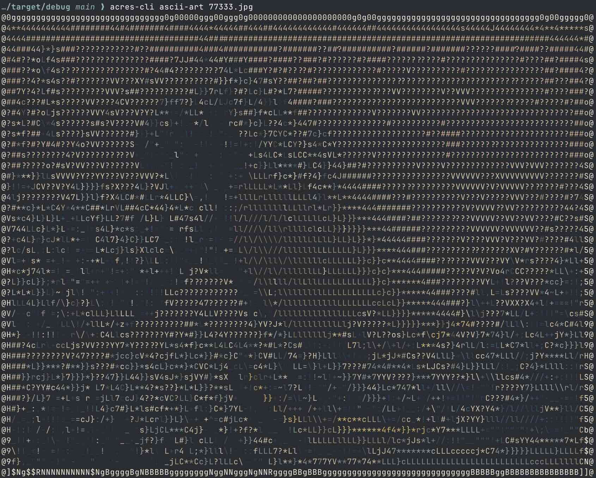
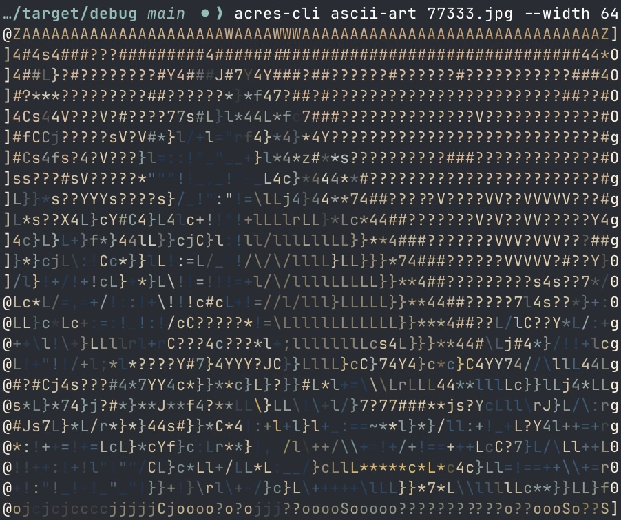

# acres

This is a collection of tools for working with [The Art Institute of Chicago API](https://api.artic.edu/docs/#introduction) in [Rust](https://rust-lang.org/):

- [`acres`](./acres/): A library for easy, ergonomic programming against the Art Institute API
- [`iiif`](./iiif/): A library for working with servers implementing supporting [International Image Interoperability API 2.0](https://iiif.io/api/image/2.0/).
- [`image-to-ascii-builder`](./image-to-ascii-builder/): A library that implements the [builder pattern](https://rust-unofficial.github.io/patterns/patterns/creational/builder.html) for the awesome [`image-to-ascii`](https://github.com/kpberry/image-to-ascii) library, now kept as the benchmark baseline for `charaoke`.
- [`charaoke`](./charaoke/): A from-scratch, performance-focused image-to-ASCII engine for live terminal rendering, used by the CLI and TUI.
- [`acres-cli`](./acres-cli): A command-line UI using the great [Clap](https://github.com/clap-rs/clap) tool.
- [`acres-tui`](./acres-tui): A terminal UI using the fantastic [Ratatui](https://ratatui.rs/) framework

The CLI was originally inspired by the Art Institute's [`aic-bash`](https://github.com/art-institute-of-chicago/aic-bash) utility for generating ASCII art but evolved to be something of a Swiss Army Knife for working with the [Artworks collection](https://api.artic.edu/docs/#collections-3).
Currently, it includes
- an [`artworks` command](#working-with-the-artworks-collection) for finding and inspecting pieces from the collection,
- an [`iiif` command](#working-with-iiif-urls) for constructing IIIF URLs for downloading images for the artwork you find, and
- an [`ascii-art` tool](#working-with-ascii-art) for rendering those images as ASCII art directly in the terminal.

The TUI is, essentially, no surprise, the interactive equivalent of the CLI: it searches the collection live.

```sh
acres-tui
```

It opens on Highlights, a short built-in list of public-domain works (the Great Wave, a few Monets, La Grande Jatte and others).
Set `highlights` in your config to a list of artwork ids to start on your own picks instead.
Pass `--offline` to answer only from the cache, or `--from-file` to browse a file of search results from the CLI (`-` reads stdin):

```sh
acres-cli artworks > artworks.json
acres-tui --from-file artworks.json
acres-tui --offline --from-file saved.json  # your saved artworks, without the network
```

The TUI opens on an explorer: a search bar along the top, then the results, the art and the artwork's record side by side, and a status bar along the bottom.
Each pane is numbered in its top border, and `1` to `4` (or `tab` and `shift-tab`) move focus between them.
Hit `?` for every key, listed for the focused pane first, and `esc` to close it.

- `j` and `k` (or the arrows) move through the results, and the art and record follow, a moment after the cursor stops. `n` and `p` do the same from any pane. While you browse, the art is a soft blur of the artwork's colors, a tiny placeholder that comes with the search results and costs no download. `enter` or `space` fetches the full image, and one you've seen in full shows again at once when you come back to it.
- The record pane reads like a museum wall label: artist, title and date, medium, credit line and reference number. With it focused (`4`), `d` expands it to the full record, with dimensions, place, department, where it hangs and the description, and `enter` opens the full record in a large overlay. `o` opens the artwork on artic.edu and `y` copies its link.
- `/` opens the search bar, and `enter` searches the collection for what you typed (an empty search goes back to Highlights). More results load as you near the end of the list. With `--from-file`, the search narrows the list to titles containing what you typed instead. `up` and `down` recall earlier searches.
- `f` opens the filters: image, public domain, on view, department, artwork type and a range of years. `h`/`l` change a row, digits type a year, `enter` applies and `esc` cancels. Filters work without any search text too, to browse the whole collection. `s` cycles the sort: relevance, oldest, newest and title. Sorted, a search keeps only artworks whose title or artist has every word you typed.
- `A` lists more by the selected artwork's artist and `D` more from its department, keeping your filters and sort. `R` shows a surprise: a random artwork from the first 1,000 that match your search and filters (with `--from-file`, a random row). `backspace` goes back to the list before, with the cursor where you left it.
- `m` saves the selected artwork, or unsaves it, and saved ones are marked `*` in the results. `'` switches to the saved list and back, and `e` writes a one-line note on a saved artwork, shown under its wall label. The list is kept in `saved.json` in the data directory (`acres-tui --version` prints it) with each record whole, so it opens offline, and `--from-file saved.json` opens it too.
- `b` cycles the art from half blocks to quadrant blocks to ASCII, and `r` picks a different ramp, the characters ASCII mode draws with.
- `z` shows the art alone, full screen, until `esc` or `z` again.
- `t` slides out a HUD over the right of the art with how long each fetch, decode, render and frame took, and `L` slides the log out over the left.
- The mouse works too: scroll the list or the record, click a row to select it, and click a pane to focus it. Set `mouse: false` in the config to keep your terminal's own text selection.

The status bar counts the results, says when the rate limit is holding a search up, shows a few useful keys for the focused pane and echoes the last key you pressed with what it did, or `not mapped here` when it did nothing there (`show_keys: false` turns that off).
Keys are set in `acres-tui/.config/config.json5`, per pane, and your own config can override any of them.

When you're done, hit `q`, then `q` or `enter` again to confirm (`esc` stays). `ctrl-c` quits without asking.


<a href="https://vhs.charm.sh">
  
</a>

## The CLI

Every command goes through one rate-limited client (60 requests a minute, as the API asks, shared by every run and the TUI) and an on-disk cache: images are kept for good, records for 7 days and search or listing pages for 24 hours. Pass `--offline` (or set `ACRES_OFFLINE=true`) to answer only from the cache, and set `ACRES_CONTACT` to add a contact to the `AIC-User-Agent` header the API asks for.

### Working with the Artworks Collection

List artworks with

```sh
acres-cli artworks
```

For the first example [here](https://api.artic.edu/docs/#get-artworks-2), you'd do

```sh
acres-cli artworks --limit 2 | jq '{ pagination: .pagination, data: .data[] | { id: .id, title: .title, api_link: .api_link } }'
```

to get

```json
{
  "pagination": {
    "current_page": 1,
    "limit": 2,
    "next_url": "https://api.artic.edu/api/v1/artworks?page=2&limit=2",
    "offset": 0,
    "total": 129568,
    "total_pages": 64784
  },
  "data": {
    "id": 161,
    "title": "Skyphos (Drinking Cup)",
    "api_link": "https://api.artic.edu/api/v1/artworks/161"
  }
}
{
  "pagination": {
    "current_page": 1,
    "limit": 2,
    "next_url": "https://api.artic.edu/api/v1/artworks?page=2&limit=2",
    "offset": 0,
    "total": 129568,
    "total_pages": 64784
  },
  "data": {
    "id": 22,
    "title": "Villa Pamphili outside Porta S. Pancrazio, from Views of Rome",
    "api_link": "https://api.artic.edu/api/v1/artworks/22"
  }
}
```

The only output from `artworks` is the JSON response so that you can easily write it to a local `.json` file or pipe it on to anything that can consume JSON.
We're using `jq` here to pare down the results and pretty-print them. 

[Search the collection](https://api.artic.edu/docs/#get-artworks-search-2) with

```
acres-cli artworks-search
```

```sh
acres-cli artworks-search --q monet
```

[Get a specific piece from the collection](https://api.artic.edu/docs/#get-artworks-id-2) with

```sh
acres-cli artwork <id>
```

The example from the website would look like

```sh
acres-cli artwork 4 \
    | jq '{ title: .data.title, artist: .data.artist_display, date: .data.date_display, medium: .data.medium_display }'
```

and would print out

```json
{
  "title": "Priest and Boy",
  "artist": "Lawrence Carmichael Earle\nAmerican, 1845-1921",
  "date": "n.d.",
  "medium": "Watercolor over graphite on cream wove paper"
}
```

Again, the output from the CLI is the full JSON and we're just using `jq` to wrangle it into what we want.

[Get manifest for a specific piece from the collection](https://api.artic.edu/docs/#get-artworks-id-manifest-json-2) with

```sh
acres-cli artwork-manifest <id>
```

Following the example from the website would look like

```sh
acres-cli artwork-manifest 4
```


If you're looking for programmatic access to the artworks collection directly in Rust, check out the `acres` crate.

### Working with IIIF URLs

You'll need to use the [IIIF image API](https://api.artic.edu/docs/#iiif-image-api) to download images for the artwork you find.
The `iiif` tool helps with this by converting the artwork info you've collected into IIIF URLs for retrieving the associated images.

```sh
acres-cli iiif <artwork-info>
```

For example,

```sh
% acres-cli artwork 77333 | acres-cli iiif -
https://www.artic.edu/iiif/2/3eec80ab-bad4-8b35-1adb-57b7e7cb7adb/full/843,/0/default.jpg
```

Or, without the piping,

```sh
% acres-cli artwork 77333 > 77333.json
% acres-cli iiif 77333.json
https://www.artic.edu/iiif/2/3eec80ab-bad4-8b35-1adb-57b7e7cb7adb/full/843,/0/default.jpg
```

But we're not super strict about what the input for the `iiif` tool.
It really only needs to have the necessary information.
So you could have some intermediate filtering, like

```sh
% acres-cli artwork 77333 \
    | jq '{ config: { iiif_url: .config.iiif_url }, data: { id: .data.id,  image_id: .data.image_id, title: .data.title  } }'
    | acres-cli iiif -
https://www.artic.edu/iiif/2/3eec80ab-bad4-8b35-1adb-57b7e7cb7adb/full/843,/0/default.jpg
```

The recommended default URL is easy enough to construct from the IIIF URL and image ID.
But the strength of the `iiif` tool comes in when you want to adjust the request.
For example, you can change the quality to retrieve the black-and-white variant as a PNG:

```sh
% acres-cli iiif 77333.json --quality bitonal --format png
https://www.artic.edu/iiif/2/3eec80ab-bad4-8b35-1adb-57b7e7cb7adb/full/843,/0/bitonal.png
```

### Working with ASCII Art

Once you have images, why not make ASCII art?
It's this simple:

```sh
acres-cli ascii-art <image>
```

Following on from the previous examples,

```sh
% curl $(acres-cli iiif 77333.json) --output 77333.jpg
% acres-cli ascii-art 77333.jpg
```



Of course you can mix and match settings, like changing the image quality to bi-tonal and setting the ramp to use for the ASCII art to fast (just `#`s):

```sh
curl -s $(acres-cli iiif 77333.json --quality bitonal) | acres-cli ascii-art - --ramp fast
```

`--ramp` takes a preset (`alphabet`, the default, `fast`, `letters`, `lowercase`, `minimal`, `symbols` or `uppercase`) or your own characters from darkest to brightest, like `--ramp ' .:#'`.


By default, this will match the width of your terminal.
But you can control how wide it is by setting `--width` like so

```sh
% acres-cli ascii-art 77333.jpg --width 64
```



Color follows your terminal: truecolor when `COLORTERM` says so, 256-color otherwise, and plain text when you redirect the output or set `NO_COLOR`.
Pass `--color truecolor`, `--color 256` or `--color never` to choose yourself, for example to keep color in a file:

```sh
% acres-cli ascii-art 77333.jpg --color truecolor > 77333.ans
```

For more detail in full color, draw with block glyphs instead of characters.
`--mode half` draws `▀` in two colors, two pixels per cell, and `--mode quadrant` draws quadrant blocks, four pixels per cell.
Block modes need color, so they don't work with `--color never` or when `auto` turns color off:

```sh
% acres-cli ascii-art 77333.jpg --mode half
```

Add `--timings` to see how long each stage took. The timings go to stderr after the art, so they never break up the image.

As before, you can pipe bytes into this:

```sh
% acres-cli artwork 77333 \
    | acres-cli iiif - --to bytes \
    | acres-cli ascii-art - --width 32
[...]
```

Or, equivalently,

```sh
% acres-cli artwork 77333 \
    | acres-cli iiif - \
    | acres-cli ascii-art - --from url --width 32
[...]
```

## License

Licensed under either of

 * Apache License, Version 2.0
   ([LICENSE-APACHE](LICENSE-APACHE) or <http://www.apache.org/licenses/LICENSE-2.0>)
 * MIT license
   ([LICENSE-MIT](LICENSE-MIT) or <http://opensource.org/licenses/MIT>)

at your option.

## Contribution

Unless you explicitly state otherwise, any contribution intentionally submitted
for inclusion in the work by you, as defined in the Apache-2.0 license, shall be
dual licensed as above, without any additional terms or conditions.

