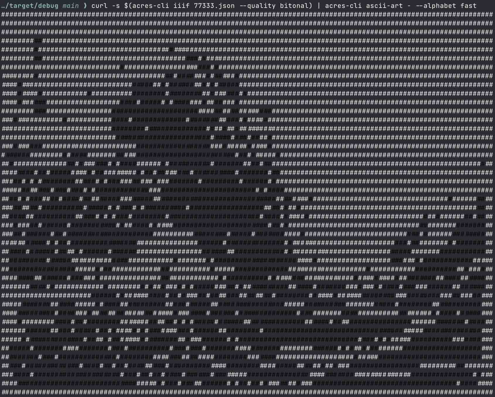

# acres

This is a collection of tools for working with [The Art Institute of Chicago API](https://api.artic.edu/docs/#introduction) in [Rust](https://rust-lang.org/):

- [`acres-cli`](./acres-cli): A command-line UI using the great [Clap](https://github.com/clap-rs/clap) tool.
- [`acres-tui`](./acres-tui): A terminal UI using the fantastic [Ratatui](https://ratatui.rs/) framework.
- [`acres`](./acres/): A library for easy, ergonomic programming against the Art Institute API.
- [`iiif`](./iiif/): A library for building requests to servers that implement the [International Image Interoperability Framework (IIIF) Image API 2.0](https://iiif.io/api/image/2.0/).
- [`charaoke`](./charaoke/): A from-scratch, performance-focused image-to-ASCII engine for live terminal rendering, used by the CLI and TUI.
- [`image-to-ascii-builder`](./image-to-ascii-builder/): A [builder](https://rust-unofficial.github.io/patterns/patterns/creational/builder.html) for the awesome [`image-to-ascii`](https://github.com/kpberry/image-to-ascii) library, kept only as the benchmark baseline for `charaoke`.

## Install

Prebuilt `acres-cli` and `acres-tui` binaries for Linux (x86-64 and arm64), macOS (Apple silicon) and Windows are attached to each [GitHub release](https://github.com/dylan-stark/acres/releases).
Download the archive for your platform, unpack it and put the binaries on your `PATH`.

To build from source instead, install Rust with [rustup](https://rustup.rs/) and run

```sh
cargo install --locked --git https://github.com/dylan-stark/acres acres-cli acres-tui
```

The TUI looks best in a terminal with truecolor support (most modern terminals set `COLORTERM=truecolor`); elsewhere it falls back to 256 colors.

## The TUI

The TUI is the interactive equivalent of the CLI: it searches the collection live.

```sh
acres-tui
```

To get going: type `/`, a search such as `monet` and `enter`; move with `j` and `k`; press `enter` to fetch the full image; and `z` to see it full screen. `?` lists every key.

It opens on Highlights, a short built-in list of public-domain works (the Great Wave, a few Monets, La Grande Jatte and others).
Set `highlights` in your config to a list of artwork ids to start on your own picks instead.
Pass `--offline` to answer only from the cache, or `--from-file` to browse a file of search results from the CLI (`-` reads stdin):

```sh
acres-cli artworks > artworks.json
acres-tui --from-file artworks.json
acres-tui --offline --from-file saved.json  # your saved artworks, without the network
```

The TUI opens on an explorer: a search bar along the top, then the results, the art and the artwork's record side by side, and a status bar along the bottom.
Each pane is numbered in its top border, and `1` to `4` (or `tab` and `shift-tab`) move focus between them.
Hit `?` for every key, listed for the focused pane first, and `esc` to close it.

- `j` and `k` (or the arrows) move through the results, and the art and record follow, a moment after the cursor stops. `n` and `p` do the same from any pane. While you browse, the art shows only images already on disk from an earlier fetch, so browsing downloads nothing. Each row starts with a dim `•` when its image is on disk and `◦` when it needs a fetch, and `enter` or `space` fetches it.
- The record pane reads like a museum wall label: artist, title and date, medium, credit line and reference number. With it focused (`4`), `d` expands it to the full record, with dimensions, place, department, where it hangs and the description, and `enter` opens the full record in a large overlay. `o` opens the artwork on artic.edu and `y` copies its link.
- `/` opens the search bar, and `enter` searches the collection for what you typed (an empty search goes back to Highlights). More results load as you near the end of the list. With `--from-file`, the search narrows the list to titles containing what you typed instead. `up` and `down` recall earlier searches.
- `f` opens the filters: image, public domain, on view, department, artwork type and a range of years. `h`/`l` change a row, digits type a year, `enter` applies and `esc` cancels. Filters work without any search text too, to browse the whole collection. `s` cycles the sort: relevance, oldest, newest and title. Sorted, a search keeps only artworks whose title or artist has every word you typed.
- `A` lists more by the selected artwork's artist and `D` more from its department, keeping your filters and sort. `R` shows a surprise: a random artwork from the first 1,000 that match your search and filters (with `--from-file`, a random row). `backspace` goes back to the list before, with the cursor where you left it.
- `m` saves the selected artwork, or unsaves it, and saved ones are marked `*` in the results. `'` switches to the saved list and back, and `e` writes a one-line note on a saved artwork, shown under its wall label. The list is kept in `saved.json` in the data directory (`acres-tui --version` prints it) with each record whole, so it opens offline, and `--from-file saved.json` opens it too.
- `b` cycles the art from half blocks to quadrant blocks to ASCII, and `r` picks a different ramp, the characters ASCII mode draws with.
- `z` shows the art alone, full screen, until `esc` or `z` again.
- With the art focused, or in zen, `+` and `-` zoom (scrolling over the art zooms about the pointer), `h j k l` or the arrows pan by a cell (shifted, by a tenth of the view, and dragging pans too), `F` fills the frame with no letterbox and `0` fits the whole image again. Up close the 843-pixel image turns into even blocks of color. A minimap shows where you are while you move. `S` picks the frame the art is drawn on: the pane, the whole screen, a 20 x 12 Stamp, a 60 x 20 Postcard or any size up to the terminal's. `v` saves the view under a name (saving the artwork too), `V` lists the saved views to show, rename (`e`) or delete (`x`), and `X` exports the art as an `.ans` file you can `cat` (plus `.txt` in ASCII mode) to `exports/` in the data directory.
- `t` slides out a HUD over the right of the art with how long each fetch, decode, render and frame took. The log is `acres-tui.log` in the data directory (`acres-tui --version` prints where that is). It is kept across runs, and `ACRES_TUI_LOGLEVEL=debug` adds each request's outcome.
- The mouse works too: scroll the list or the record, click a row to select it, and click a pane to focus it. Set `mouse: false` in the config to keep your terminal's own text selection.

The status bar counts the results, says when the rate limit is holding a search up, shows a few useful keys for the focused pane and echoes the last key you pressed with what it did, or `not mapped here` when it did nothing there (`show_keys: false` turns that off). When something you asked for fails, such as fetching the full image, it says so in red with a hint on what to do next, until your next key. In zen it pops up over the bottom of the art instead, and `!` shows the last failure again.
Keys are set in `acres-tui/.config/config.json5`, per pane, and your own config can override any of them.

When you're done, hit `q`, then `q` or `enter` again to confirm (`esc` stays). `ctrl-c` quits without asking.


<a href="https://vhs.charm.sh">
  
</a>

## The CLI

The CLI was originally inspired by the Art Institute's [`aic-bash`](https://github.com/art-institute-of-chicago/aic-bash) utility for generating ASCII art but evolved to be something of a Swiss Army Knife for working with the [Artworks collection](https://api.artic.edu/docs/#collections-3).
Currently, it includes
- an [`artworks` command](#working-with-the-artworks-collection) for finding and inspecting pieces from the collection,
- an [`iiif` command](#working-with-iiif-urls) for constructing IIIF URLs for downloading images for the artwork you find, and
- an [`ascii-art` tool](#working-with-ascii-art) for rendering those images as ASCII art directly in the terminal.

The commands are `artwork`, `artwork-manifest`, `artworks` and `artworks-search` to fetch from the collection, `iiif` and `iiif-info` for an artwork's image URL and IIIF image information, `ascii-art` to draw an image in the terminal, and `config` to show the settings in effect and where files live. `acres-cli <command> --help` covers each one.

Every command goes through one rate-limited client (60 requests a minute, as the API asks, shared by every run and the TUI) and an on-disk cache: images are kept for good, records for 7 days and search or listing pages for 24 hours. Pass `--offline` (or set `ACRES_OFFLINE=true`) to answer only from the cache, and set `ACRES_CONTACT` to add a contact to the `AIC-User-Agent` header the API asks for.

Warnings go to stderr. Add `-v` to also see each request's outcome (whether it came from the cache, how long it waited for the rate limit and how long the fetch took), `-vv` for more detail, `-vvv` for everything including how long each request took end to end, or `-q` for no logging at all. `RUST_LOG` overrides these when set. [`docs/LOGGING.md`](docs/LOGGING.md) has the levels and fields.

### Errors and exit codes

Errors go to stderr, so stdout only ever holds data. Each one says what went wrong and, where it can, what to do next:

```console
$ acres-cli --offline artwork 27992
error: not cached while offline: https://api.artic.edu/api/v1/artworks/27992
hint: go online (unset ACRES_OFFLINE, or drop --offline) to fetch it once
```

For scripts and agents, `--error-format json` (or `ACRES_ERROR_FORMAT=json`) writes one line of JSON instead, with a stable `kind` to match on:

```json
{"kind":"cache.missing","message":"not cached while offline: https://api.artic.edu/api/v1/artworks/27992","causes":[],"hint":"go online (unset ACRES_OFFLINE, or drop --offline) to fetch it once","exit_code":4}
```

The exit code says what kind of failure it was: 1 other, 2 usage, 3 not found, 4 offline and not cached, 5 transient (rate limited, network trouble or an API server error, so try again later), 6 invalid input, 7 environment (config, cache directory or files) and 8 a response acres can't read. `acres-cli --help` lists them, and [`docs/ERROR-HANDLING.md`](docs/ERROR-HANDLING.md) has the details. `acres-tui` reports a failure that stops it, such as a bad config file, the same way and with the same exit codes.

### Working with the Artworks Collection

List artworks with

```sh
acres-cli artworks
```

For the first example [here](https://api.artic.edu/docs/#get-artworks-2), you'd do

```sh
acres-cli artworks --limit 2 | jq '{ pagination: .pagination, data: .data[] | { id: .id, title: .title, api_link: .api_link } }'
```

to get

```json
{
  "pagination": {
    "current_page": 1,
    "limit": 2,
    "next_url": "https://api.artic.edu/api/v1/artworks?page=2&limit=2",
    "offset": 0,
    "total": 129568,
    "total_pages": 64784
  },
  "data": {
    "id": 161,
    "title": "Skyphos (Drinking Cup)",
    "api_link": "https://api.artic.edu/api/v1/artworks/161"
  }
}
{
  "pagination": {
    "current_page": 1,
    "limit": 2,
    "next_url": "https://api.artic.edu/api/v1/artworks?page=2&limit=2",
    "offset": 0,
    "total": 129568,
    "total_pages": 64784
  },
  "data": {
    "id": 22,
    "title": "Villa Pamphili outside Porta S. Pancrazio, from Views of Rome",
    "api_link": "https://api.artic.edu/api/v1/artworks/22"
  }
}
```

The only output from `artworks` is the JSON response so that you can easily write it to a local `.json` file or pipe it on to anything that can consume JSON.
We're using `jq` here to pare down the results and pretty-print them. 

[Search the collection](https://api.artic.edu/docs/#get-artworks-search-2) with

```
acres-cli artworks-search
```

```sh
acres-cli artworks-search --q monet
```

[Get a specific piece from the collection](https://api.artic.edu/docs/#get-artworks-id-2) with

```sh
acres-cli artwork <id>
```

The example from the website would look like

```sh
acres-cli artwork 4 \
    | jq '{ title: .data.title, artist: .data.artist_display, date: .data.date_display, medium: .data.medium_display }'
```

and would print out

```json
{
  "title": "Priest and Boy",
  "artist": "Lawrence Carmichael Earle\nAmerican, 1845-1921",
  "date": "n.d.",
  "medium": "Watercolor over graphite on cream wove paper"
}
```

Again, the output from the CLI is the full JSON and we're just using `jq` to wrangle it into what we want.

[Get manifest for a specific piece from the collection](https://api.artic.edu/docs/#get-artworks-id-manifest-json-2) with

```sh
acres-cli artwork-manifest <id>
```

Following the example from the website would look like

```sh
acres-cli artwork-manifest 4
```


If you're looking for programmatic access to the artworks collection directly in Rust, check out the `acres` crate.

### Working with IIIF URLs

You'll need to use the [IIIF image API](https://api.artic.edu/docs/#iiif-image-api) to download images for the artwork you find.
The `iiif` tool helps with this by converting the artwork info you've collected into IIIF URLs for retrieving the associated images.

```sh
acres-cli iiif <artwork-info>
```

For example,

```sh
% acres-cli artwork 77333 | acres-cli iiif -
https://www.artic.edu/iiif/2/3eec80ab-bad4-8b35-1adb-57b7e7cb7adb/full/843,/0/default.jpg
```

Or, without the piping,

```sh
% acres-cli artwork 77333 > 77333.json
% acres-cli iiif 77333.json
https://www.artic.edu/iiif/2/3eec80ab-bad4-8b35-1adb-57b7e7cb7adb/full/843,/0/default.jpg
```

But we're not super strict about what the input for the `iiif` tool.
It really only needs to have the necessary information.
So you could have some intermediate filtering, like

```sh
% acres-cli artwork 77333 \
    | jq '{ config: { iiif_url: .config.iiif_url }, data: { id: .data.id,  image_id: .data.image_id, title: .data.title  } }'
    | acres-cli iiif -
https://www.artic.edu/iiif/2/3eec80ab-bad4-8b35-1adb-57b7e7cb7adb/full/843,/0/default.jpg
```

The recommended default URL is easy enough to construct from the IIIF URL and image ID.
But the strength of the `iiif` tool comes in when you want to adjust the request.
For example, you can change the quality to retrieve the black-and-white variant as a PNG:

```sh
% acres-cli iiif 77333.json --quality bitonal --format png
https://www.artic.edu/iiif/2/3eec80ab-bad4-8b35-1adb-57b7e7cb7adb/full/843,/0/bitonal.png
```

To see what sizes and tiles the image server offers for an artwork, `iiif-info` fetches its IIIF image information (`info.json`):

```sh
acres-cli artwork 77333 | acres-cli iiif-info -
```

### Working with ASCII Art

Once you have images, why not make ASCII art?
It's this simple:

```sh
acres-cli ascii-art <image>
```

Following on from the previous examples,

```sh
% curl $(acres-cli iiif 77333.json) --output 77333.jpg
% acres-cli ascii-art 77333.jpg
```


Of course you can mix and match settings, like changing the image quality to bi-tonal and setting the ramp to use for the ASCII art to fast (just `#`s):

```sh
curl -s $(acres-cli iiif 77333.json --quality bitonal) | acres-cli ascii-art - --ramp fast
```

`--ramp` takes a preset (`alphabet`, the default, `fast`, `letters`, `lowercase`, `minimal`, `symbols` or `uppercase`) or your own characters from darkest to brightest, like `--ramp ' .:#'`.



By default, this will match the width of your terminal.
But you can control how wide it is by setting `--width` like so

```sh
% acres-cli ascii-art 77333.jpg --width 64
```


Color follows your terminal: truecolor when `COLORTERM` says so, 256-color otherwise, and plain text when you redirect the output or set `NO_COLOR`.
Pass `--color truecolor`, `--color 256` or `--color never` to choose yourself, for example to keep color in a file:

```sh
% acres-cli ascii-art 77333.jpg --color truecolor > 77333.ans
```

For more detail in full color, draw with block glyphs instead of characters.
`--mode half` draws `▀` in two colors, two pixels per cell, and `--mode quadrant` draws quadrant blocks, four pixels per cell.
Block modes need color, so they don't work with `--color never` or when `auto` turns color off:

```sh
% acres-cli ascii-art 77333.jpg --mode half
```

Add `--timings` to see how long each stage took. The timings go to stderr after the art, so they never break up the image.

As before, you can pipe bytes into this:

```sh
% acres-cli artwork 77333 \
    | acres-cli iiif - --to bytes \
    | acres-cli ascii-art - --width 32
[...]
```

Or, equivalently,

```sh
% acres-cli artwork 77333 \
    | acres-cli iiif - \
    | acres-cli ascii-art - --from url --width 32
[...]
```

## Configuration

Both tools read these environment variables. Flags such as `--offline` override them.

| Variable | What it does | Default |
| --- | --- | --- |
| `ACRES_OFFLINE` | `true` answers only from the cache, without touching the network | `false` |
| `ACRES_CONTACT` | A contact, such as an email address, added to the `AIC-User-Agent` header | none |
| `ACRES_CACHE_DIR` | Where responses and images are cached | the platform cache directory |
| `ACRES_USE_CACHE` | `false` turns the cache off, so every request goes to the network | `true` |
| `ACRES_STATE_DIR` | Where the rate limit shared between runs is kept | the platform state directory |
| `ACRES_BASE_URI` | The API to talk to | `https://api.artic.edu/api/v1` |
| `ACRES_ERROR_FORMAT` | `json` writes CLI errors as one line of JSON | `text` |
| `ACRES_TUI_CONFIG` | The TUI's config directory | the platform config directory |
| `ACRES_TUI_DATA` | The TUI's data directory: saved artworks, exports and the log | the platform data directory |
| `ACRES_TUI_LOGLEVEL` | The TUI's log level, such as `debug` or `trace` | `info` |
| `RUST_LOG` | Overrides the log level of either tool | none |
| `NO_COLOR` | Turns off colored CLI logs | unset |

A bad value, such as `ACRES_OFFLINE=maybe`, stops either tool with an error naming the variable, and exit code 7.

The TUI also reads `config.json5` (or `.json`, `.yaml`, `.toml`, `.ini`) from its config directory.
Any key in the built-in [`acres-tui/.config/config.json5`](acres-tui/.config/config.json5) can be overridden there, as well as these settings:

```json5
{
  "highlights": [24645, 16568, 27992], // artwork ids to start on, instead of the built-in Highlights
  "mouse": false, // leave the mouse to the terminal, for its own text selection
  "show_keys": false, // don't echo the last key in the status bar
  "keybindings": { "Global": { "<Ctrl-q>": "Quit" } },
}
```

### Where files live

| What | Linux | macOS |
| --- | --- | --- |
| Cache | `~/.cache/acres` | `~/Library/Caches/com.acres.acres` |
| Shared rate limit (`rate-limit`) | `~/.local/state/acres` | `~/Library/Application Support/com.acres.acres` |
| TUI config | `~/.config/acres-tui` | `~/Library/Application Support/com.aic.acres-tui` |
| TUI data (`saved.json`, `exports/`, `acres-tui.log`) | `~/.local/share/acres-tui` | `~/Library/Application Support/com.aic.acres-tui` |

`acres-cli config` prints the settings in effect, the cache directory and its size, and the rate-limit file, as JSON.
`acres-tui --version` prints the TUI's config and data directories, its log file and the cache directory.
On Windows they are under `%LOCALAPPDATA%`, and both commands say exactly where.

Everything in the cache can be fetched again, so deleting the cache directory is always safe.

## Troubleshooting

- **`not cached while offline` (exit 4).** The artwork hasn't been fetched yet. Go online (drop `--offline` or `ACRES_OFFLINE`) to fetch it once.
- **`rate limited` in the status bar, or exit 5 from the CLI.** The API allows 60 requests a minute, shared by every run on the machine. Wait a minute and try again.
- **The TUI won't start because of the config (exit 7).** The message names the bad key or setting. Fix it in the config file, or remove the file to go back to the defaults.
- **Colors look wrong or banded.** Your terminal may not advertise truecolor. Set `COLORTERM=truecolor` if it supports it, or press `b` for ASCII mode.
- **You can't select text in the TUI.** Set `"mouse": false` in the config.
- **Something failed and you want to know why.** Run the CLI with `-v` (or `-vv`), or start the TUI with `ACRES_TUI_LOGLEVEL=debug` and read `acres-tui.log`. In the TUI, `!` shows the last failure again.

Anything else is worth [an issue](https://github.com/dylan-stark/acres/issues).

## License

Licensed under either of

 * Apache License, Version 2.0
   ([LICENSE-APACHE](LICENSE-APACHE) or <http://www.apache.org/licenses/LICENSE-2.0>)
 * MIT license
   ([LICENSE-MIT](LICENSE-MIT) or <http://opensource.org/licenses/MIT>)

at your option.

## Contribution

[`CONTRIBUTING.md`](CONTRIBUTING.md) covers building, testing and the conventions, and [`docs/RELEASING.md`](docs/RELEASING.md) how a release is cut.

Unless you explicitly state otherwise, any contribution intentionally submitted
for inclusion in the work by you, as defined in the Apache-2.0 license, shall be
dual licensed as above, without any additional terms or conditions.

